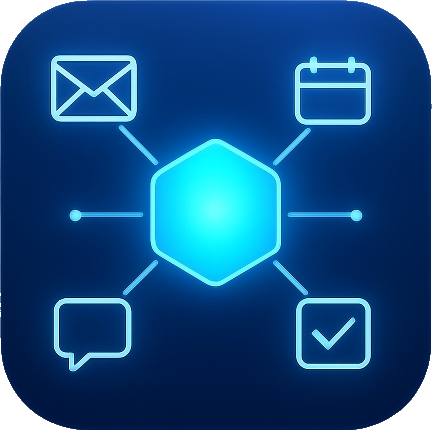

# AIA - AI-Powered Personal Productivity Assistant

<p align="center">
  
</p>

<p align="center">
  <a href="https://github.com/ffredyk/AIA/actions/workflows/dotnet.yml">
    
  </a>
</p>

<p align="center">
  <strong>A modern, extensible WPF desktop application for intelligent task management, reminders, and AI-powered productivity with advanced automation capabilities</strong>
</p>


<p align="center">
  <a href="#features">Features</a> •
  <a href="#installation">Installation</a> •
  <a href="#usage">Usage</a> •
  <a href="#ai-integration">AI Integration</a> •
  <a href="#automation">Automation</a> •
  <a href="#plugin-system">Plugin System</a> •
  <a href="#development">Development</a>
</p>


---

## Overview

**AIA (AI Assistant)** is a comprehensive personal productivity application built with WPF (.NET 10) that combines intelligent task management, smart reminders, data organization, AI-powered assistance with **vision capabilities**, and **advanced automation** in a sleek, modern interface. The application runs as an always-available overlay accessible via a global hotkey, featuring a powerful plugin system for extending functionality.

## Features

### 📋 Task Management
- **Hierarchical Tasks**: Create tasks with unlimited subtask nesting
- **Multiple Statuses**: Not Started, In Progress, On Hold, Completed, Cancelled
- **Priority Levels**: Low, Medium, High, Critical with visual indicators
- **Due Dates**: Set deadlines with automatic overdue detection
- **Progress Tracking**: Visual progress indicators for tasks with subtasks
- **Tags & Dependencies**: Tag tasks and create task dependencies
- **Recurrence**: Configure recurring tasks (daily, weekly, monthly, yearly)
- **Bulk Operations**: Multi-select and batch edit tasks
- **Templates**: Save and reuse task templates
- **Filters**: Advanced filtering by status, priority, tags, and more
- **Archive**: Archive completed tasks for clean workspace
- **Import/Export**: Export/import tasks for backup or sharing

### ⏰ Smart Reminders
- **Flexible Scheduling**: Set reminders for any date and time with time picker
- **Severity Levels**: Low, Medium, High, Urgent with color-coded indicators
- **Desktop Notifications**: Native reminder notification windows with:
  - Countdown timer display
  - View, Complete, and Snooze actions
  - Auto-dismiss after configurable duration
  - Multiple simultaneous notifications support
- **Snooze Options**: Quick snooze (5, 10, 15, 30, 60 minutes)
- **Overdue Tracking**: Visual indicators and time-since-overdue display
- **Advanced Notification Settings**:
  - Warning notifications (X minutes before due)
  - Urgent notifications (final minutes)
  - Overdue notifications
  - Configurable check intervals
  - Optional sound alerts

### 📅 Calendar
- **Agenda View**: See upcoming events in a sorted list
- **Event Editor**: Title, description, location, all-day, start/end, recurrence, reminder offset
- **Local Storage**: Events persist in `userdata/calendar-events.json`
- **Mobile Sync**: Calendar events sync with the Android companion app

### 📱 Android Companion
- **Two-Way Sync**: Tasks, reminders, and calendar events over HTTPS
- **Offline First**: Local SQLite store with revision-based conflict handling
- **Pairing**: One-time code and QR deep link, per-device revocable tokens
- **Phone Calendar**: Mirror events and due reminders into a local `AIA` calendar
- **Notifications**: Local reminder and event notifications
- **Public Access**: Designed for Cloudflare Tunnel, Tailscale Funnel, or a reverse proxy

See [docs/mobile-sync.md](docs/mobile-sync.md) for setup and security details.

### 🗂️ Data Banks
- **Organized Categories**: Create custom categories with color coding
- **Multiple Entry Types**:
  - Text entries
  - Text files (.txt, .md, .json, .xml, .csv, .log, etc.)
  - PDF documents (with text extraction)
  - Images (PNG, JPG, BMP, GIF, WebP, ICO)
  - Email content (.eml, .msg)
  - Custom formats
- **File Import**: Drag-and-drop or browse to import files
- **Tagging System**: Add searchable tags to entries
- **Preview Support**: Built-in preview for images and text content
- **Secure Storage**: Local file-based storage with organized folder structure
- **Quick Actions**: Edit, delete, open file, and save to disk
- **Category Management**: Create, rename, color-code, and delete categories

### 📸 Screen Capture & Data Assets
- **Multiple Capture Methods**:
  - Full screen capture
  - Active window tracking and capture (last 3 active windows)
  - Intelligent window exclusion (skips overlay window)
  - Recent clipboard history tracking (last 10 items)
- **Clipboard History**:
  - Text content tracking
  - Image content tracking
  - File paths tracking
  - Restore any clipboard item
  - Clear history
- **Quick Actions**:
  - Copy to clipboard
  - Save to file (PNG, JPEG, BMP)
  - Save with custom location
  - **Save directly to Data Bank**
- **Auto-Refresh**: Automatic capture when overlay opens
- **Thumbnail Generation**: Automatic thumbnail creation for quick preview
- **Time-stamped**: All captures include timestamp for easy reference

### 💬 AI Chat Integration with Vision
- **Multi-Provider Support**:
  - **OpenAI** 
  - **Azure OpenAI** 
  - **Google Gemini** 
  - **Anthropic Claude** 
- **Vision Capabilities** (NEW!):
  - **Paste images** from clipboard directly into chat
  - **Analyze screenshots** captured by AIA
  - **AI can see and describe** images through tools
  - Supports all major image formats
  - Multimodal chat with text and images
- **Intelligent Routing**: Automatic provider selection based on task type
- **Tool Integration**: AI can interact with tasks, reminders, data banks, and **screenshots**
- **Context Awareness**: AI understands your current tasks, reminders, and can view your screen
- **Conversation Management**:
  - Persistent chat sessions
  - Rename conversations
  - Delete conversations
  - **Auto-naming**: Automatically generate chat titles after first message
  - **Session list** with summaries
- **Streaming Responses**: Real-time response streaming for better UX
- **Chat Templates**: Quick-access templates for common prompts

### 🔧 AI Tool Functions
The AI assistant can perform actions on your behalf:
- `get_tasks` - Retrieve and filter tasks by status, priority, tags
- `get_reminders` - Query upcoming reminders with various filters
- `get_databank_entries` - Search data bank content across categories
- `create_task` - Create new tasks with details
- `create_reminder` - Set up new reminders
- `create_databank_entry` - Add content to data banks
- `get_app_summary` - Overview of all productivity data
- **`list_available_screenshots`** - List captured screenshots and clipboard images
- **`get_screenshot_base64`** - Retrieve and analyze specific screenshots (AI vision)

### 🤖 Advanced Automation System (NEW!) BETA
- **Powerful Automation Engine**:
  - Multi-step workflows with AI agents
  - Trigger-based automation
  - Event-driven execution
  - Built-in retry and error handling
  
- **Flexible Triggers**:
  - **Manual**: User-initiated execution
  - **Clipboard**: Monitor clipboard changes (text, images, files)
  - **Hotkey**: Global keyboard shortcuts
  - **File System**: Watch folders for file changes
  - **Window Context**: React to active window changes
  - **Plugin**: Triggered by plugin events
  - **Automation Chain**: Link automations together
  - **Schedule**: Time-based recurring automations
  
- **Intelligent AI Agents**:
  - **Simple Prompt**: Single AI call with tools
  - **Multi-Step**: Iterative AI agent with multiple tool calls
  - **Orchestrator**: Spawn and coordinate sub-agents
  - Provider selection and routing
  - Token limits and iteration controls
  - Context variable passing
  
- **Rich Actions**:
  - Show notifications
  - Create tasks and reminders
  - Save to data banks
  - Copy to clipboard
  - Save to file
  - Run other automations
  - Execute plugin actions
  - Store results for later use
  
- **Advanced Features**:
  - Permissions system (tasks, reminders, data banks, filesystem, clipboard)
  - Confirmation dialogs for sensitive actions
  - Execution history with detailed traces
  - Concurrent execution limits
  - Rate limiting
  - Import/export automations
  - Execution statistics and monitoring
  
- **Automation Management**:
  - Enable/disable automations
  - One-time or recurring execution
  - Pause/resume running automations
  - Cancel execution
  - Duplicate automations
  - Comprehensive execution logs

### 🖥️ Modern UI/UX
- **Fullscreen Overlay**: Quick-access overlay with smooth slide animations
- **Always-on Task List**: Compact, transparent task list in the upper-right corner of the active screen, with largest-unit countdowns and auto-hide on cursor proximity; hides automatically when a protected app, fullscreen game, or presentation is focused
- **Task List Modes**: Drawer (edge ball that expands on hover), interactable (stays visible and accepts clicks), and relocate (collapses into a ball and moves to the opposite screen side)
- **System Tray Integration**: Runs in background with tray icon
- **Dark Theme**: Modern dark theme using WPF-UI Fluent Design
- **Fluent Design**: Windows 11 Fluent Design System aesthetics
- **Global Hotkey**: Customizable keyboard shortcut (default: `Alt+Q`; registration failures are reported in the tray)
- **Focus-Aware Hotkeys**: Detects games, fullscreen apps, presentations, remote desktop, and custom processes so AIA doesn't steal focus
- **Responsive Layout**: Adaptive layout for different screen sizes
- **Toast Notifications**: Non-intrusive toast messages for feedback
- **Tab Navigation**: Organized tabs for different features
- **Icon System**: Fluent System Icons throughout the UI
- **Smooth Animations**: Polished animations for better UX

### 🔌 Plugin System WIP
- **Modular Architecture**: Extend functionality through plugins
- **Plugin SDK**: Comprehensive SDK for building plugins
- **Granular Permission System**: Fine-grained security controls
- **Built-in Plugins**:
  - **Outlook Integration**: Sync flagged emails, view email list, mark complete
  - **Teams Integration**: View meetings, messages, join calls
  - **Discord Integration**: Browse channels, read recent messages, send replies
  - **Slack Integration**: Browse channels, read recent messages, send replies
  - **Jira Integration**: Track assigned issues, create issues, add comments
  - **GitHub Integration**: Assigned issues, review requests, notifications
  - **Azure DevOps Integration**: Work items and reviewer pull requests
  - **Trello / Asana / ClickUp**: Assigned cards and tasks with due dates
  - **Notion / Confluence**: Search pages, comment, capture into AIA
  - **Google Account**: Shared OAuth sign-in for Google plugins
  - **Gmail / Google Calendar / Google Chat**: Mail, events, spaces and messages
- **Hot-Loading**: Load/unload plugins without restarting
- **Settings Integration**: Plugins can add their own settings panels
- **UI Integration**:
  - Custom tabs with icons and badges
  - Toolbar buttons
  - Data templates for custom UI
- **Service Access**:
  - Tasks, Reminders, Data Banks, Chats
  - Data Assets (screenshots, clipboard)
  - Logging, Settings, UI services

### 🌍 Internationalization
- **Multi-language Support**: Built-in localization system
- **Language Switcher**: Easy language switching in settings
- **Extensible**: Add new languages via JSON resource files
- **Current Languages**: English (default), with framework for additional languages

---

## System Requirements

- **Operating System**: Windows 10 (Build 22000+) or Windows 11
- **Runtime**: .NET 10.0 Runtime + ASP.NET Core Runtime 10 for mobile sync
- **Optional**: .NET 10 SDK, `maui-android` workload, JDK 17, Android SDK for the Android app
- **Optional**: Microsoft Outlook (for Outlook plugin)
- **Optional**: Microsoft Teams (for Teams plugin)
- **Optional**: Discord account with a bot token (for Discord plugin)
- **Optional**: Slack workspace with a bot token (for Slack plugin)
- **Optional**: Jira Cloud site with an API token (for Jira plugin)
- **Optional**: GitHub PAT, Azure DevOps PAT, Trello API key/token, Asana PAT, ClickUp token, Notion integration token, or Confluence site/email/API token
- **Optional**: Google Cloud OAuth client (Desktop app) for Gmail, Google Calendar, and Google Chat
- **Optional**: Google Workspace account with Chat API enabled (for Google Chat plugin)
- **Optional**: AI Provider API keys (OpenAI, Azure, Google, Anthropic)

---

## Installation

### Prerequisites

1. Install [.NET 10.0 Runtime](https://dotnet.microsoft.com/download/dotnet/10.0) and the ASP.NET Core Runtime 10
   (the mobile sync API uses the ASP.NET Core shared framework). A self-contained AIA build includes both.
2. Optional Android app: install the .NET 10 SDK, run `dotnet workload install maui-android`, and install JDK 17.

### From Source

```bash
# Clone the repository
git clone https://github.com/ffredyk/AIA.git

# Navigate to the project directory
cd AIA

# Restore dependencies
dotnet restore

# Build the solution
dotnet build --configuration Release

# Run the application
dotnet run --project AIA.csproj
```

### Configuration

On first run, AIA creates its data directory under `%LOCALAPPDATA%\AIA` (older builds stored data next to the executable; that data is migrated automatically on first launch):

```
%LOCALAPPDATA%\AIA\
├── ai-config/              # AI provider configurations
│   ├── providers.json      # Provider settings (API keys DPAPI-encrypted)
│   └── settings.json       # AI behavior settings
├── databanks/              # Data bank storage
│   ├── files/              # Imported files
│   └── metadata.json       # Categories and entries
├── screenshots/            # Saved screen captures
├── automations/            # Automation definitions
│   ├── settings.json       # Automation global settings
│   ├── automation_*.json   # Individual automations
│   └── history/            # Execution history
├── settings/               # Application settings and templates
├── userdata/               # User data
│   ├── tasks.json          # Task data
│   ├── reminders.json      # Reminder data
│   ├── calendar-events.json # Calendar events
│   ├── sync-journal.json   # Mobile sync revisions/tombstones
│   ├── chats.json          # Chat history
│   └── chat-images/        # Persisted chat image attachments
├── backups/                # Application backups
└── Plugins/                # Plugin configuration and per-plugin data
```

Plugin assemblies are still loaded from `<install dir>\Plugins`; their configuration lives under `%LOCALAPPDATA%\AIA\Plugins`. A custom data location can be set in **Settings → Data** (requires a restart). Mobile device tokens live in `%LOCALAPPDATA%\AIA\settings\mobile-sync-devices.json` and are DPAPI-encrypted.

---

## Usage

### Launching the Application

1. **First Launch**: Run AIA.exe - the application minimizes to the system tray
2. **Access Overlay**: Press `Alt+Q` (or your custom hotkey) to show the overlay
3. **System Tray**: Double-click the tray icon to show the overlay

### Keyboard Shortcuts

| Shortcut | Action |
|----------|--------|
| `Alt+Q` | Toggle overlay (customizable, default) |
| `Alt+Shift+Q` | Toggle compact task list interactable mode (customizable) |
| `Escape` | Close overlay |
| `Ctrl+N` | New task (when in Tasks tab) |
| `Ctrl+R` | New reminder (when in Reminders tab) |

### Managing Tasks

1. Navigate to the **Tasks** tab
2. Click **New Task** or press `Ctrl+N`
3. Enter task details, set priority, due date, and status
4. Add subtasks using the **Add Subtask** button
5. Use **Tags** to categorize tasks
6. Create **Dependencies** between tasks
7. Set up **Recurrence** for repeating tasks
8. Use **Bulk Operations** for batch editing
9. **Save as Template** for reusable task structures
10. **Archive** completed tasks to keep your workspace clean

### Managing Reminders

1. Navigate to the **Reminders** tab
2. Click **New Reminder**
3. Set title, date/time (with time picker), and severity
4. Reminders appear as **notification windows** when due
5. Click **View** to jump to the reminder
6. Click **Complete** to mark as done
7. Use **Snooze** to delay reminders (5, 10, 15, 30, 60 min)
8. Configure notification settings in **Settings → Notifications**

### Using Data Banks

1. Navigate to the **Data Banks** tab
2. Create a category using the **+** button
3. Add entries by:
   - Clicking **+ New Entry** for text content
   - Clicking **Import File** to add files
   - Using **Save to Data Bank** from screen captures
4. Click an entry to view/edit its content
5. Use **tags** for better organization
6. **Preview** images and text files inline
7. **Open File** to view in default application

### Screen Captures & Clipboard

1. Navigate to the **Screenshots** or **Clipboard** tab
2. Captures are automatically taken when overlay opens
3. Click **Refresh** to capture current state
4. Click on any capture to preview full-size
5. Use quick actions:
   - **Copy**: Copy to clipboard
   - **Save**: Save to disk
   - **Save As**: Choose custom location
   - **Save to Data Bank**: Add to data bank category

### AI Chat with Vision

1. Navigate to the **Chat** tab
2. Configure an AI provider in **Settings → Orchestration**
3. Start a conversation:
   - Type a message and press Enter
   - Use **chat templates** for quick prompts
   - **Paste images** from clipboard (Ctrl+V) to include in your message
   - Ask AI to **analyze screenshots** from the Screenshots tab
4. The AI can:
   - **See and describe images** you send
   - **View your screenshots** through tool calls
   - Answer questions about your tasks/reminders
   - Create new tasks and reminders on request
   - Summarize your productivity data
   - Help with general queries
5. Manage conversations:
   - Click on session to switch conversations
   - Rename conversations (pencil icon)
   - Delete old conversations
   - **Auto-naming** generates titles automatically

### Creating Automations

1. Click **⚙️ Automation** in the toolbar
2. Click **New Automation**
3. Configure:
   - **Name** and **Description**
   - **Trigger**: Choose from Manual, Clipboard, Hotkey, File System, Window Context, Schedule, etc.
   - **Agent**: Select agent type (Simple, Multi-Step, Orchestrator)
   - **AI Provider**: Choose provider and model
   - **Prompt**: Define what the agent should do
   - **Actions**: Add actions to perform after agent completes
   - **Permissions**: Grant required permissions
4. **Enable** the automation
5. Monitor execution in **History** tab

### Example Automations

**Example 1: Clipboard Note Taker**
- Trigger: Clipboard (text only)
- Agent: Simple prompt with GPT-4o-mini
- Prompt: "Extract key points from this text and create a concise summary"
- Action: Save to Data Bank (Notes category)

**Example 2: Screenshot Analyzer**
- Trigger: Hotkey (Ctrl+Shift+S)
- Agent: Multi-step with GPT-4o (vision model)
- Prompt: "Analyze the current screenshot. Extract any text, describe the content, and summarize what the user was working on"
- Action: Create Task with AI summary

**Example 3: File Organizer**
- Trigger: File Change (Downloads folder)
- Agent: Simple prompt
- Prompt: "Categorize this file based on its name and extension. Suggest a category"
- Action: Create Reminder to organize file

---

## AI Integration

### Configuring AI Providers

1. Click **⚙️ Orchestration** in the toolbar
2. Click **Add Provider**
3. Select provider type and configure:
   - **OpenAI**: API Key, Model
   - **Azure OpenAI**: Endpoint, API Key, Deployment Name, Model
   - **Google Gemini**: API Key, Model
   - **Anthropic**: API Key, Model
4. Click **Test** to verify connection
5. Set as **Default** if desired
6. Configure **Strengths** for auto-routing

### Provider Capabilities

| Provider | Text Generation | Vision/Images | Tool Use | Streaming |
|----------|----------------|---------------|----------|-----------|
| OpenAI GPT-4o | ✅ | ✅ | ✅ | ✅ |
| Azure OpenAI | ✅ | ✅ | ✅ | ✅ |
| Google Gemini | ✅ | ✅ | ✅ | ✅ |
| Anthropic Claude | ✅ | ✅ | ✅ | ✅ |

### Provider Routing

AIA can automatically route requests to the best provider:

| Category | Best Providers |
|----------|---------------|
| Coding | OpenAI GPT-5, Claude |
| Math | OpenAI GPT-5, Gemini Pro |
| Creative | Claude, GPT-5 |
| Analysis | GPT-5, Gemini Pro |
| Summarization | Claude, GPT-5 |
| Task Management | Any provider |
| Vision/Images | GPT-5.2, Gemini 3.0, Claude 4.5 |

### AI Settings

Configure AI behavior in the Orchestration window:
- **Enable Auto Routing**: Automatically select best provider
- **Enable Tool Use**: Allow AI to interact with your data
- **Include Context**: Share tasks/reminders/data bank info
- **Enable Auto-Naming**: Auto-generate chat titles
- **Temperature**: Control response creativity (0.0 - 1.0)
- **Max Tokens**: Limit response length
- **Context Limits**: Control how much context to include

---

## Automation

### Automation Architecture

```
Automation System
├── Triggers                  # What starts the automation
│   ├── Manual
│   ├── Clipboard
│   ├── Hotkey
│   ├── File System
│   ├── Window Context
│   ├── Plugin
│   ├── Automation Chain
│   └── Schedule
├── AI Agent                  # What processes the input
│   ├── Simple Prompt
│   ├── Multi-Step
│   └── Orchestrator
├── Actions                   # What happens after
│   ├── Notification
│   ├── Create Task
│   ├── Create Reminder
│   ├── Save to Data Bank
│   ├── Copy to Clipboard
│   ├── Save to File
│   ├── Run Automation
│   └── Plugin Action
└── Permissions              # What is allowed
    ├── Tasks
    ├── Reminders
    ├── Data Banks
    ├── Clipboard
    ├── File System
    └── Plugins
```

### Automation Limits

Configure global limits in Automation Settings:
- **Max Concurrent Automations**: How many can run simultaneously
- **Default Max Iterations**: For multi-step agents
- **Default Max Tokens**: Token budget for agents
- **Max History Entries**: How many executions to keep
- **History Retention Days**: How long to keep history

### Execution Monitoring

View execution details in the History tab:
- **Status**: Running, Completed, Failed, Cancelled
- **Duration**: How long it took
- **Trace Log**: Detailed step-by-step execution
- **Context Snapshot**: Variables at execution time
- **Result**: Final output from agent
- **Statistics**: Success rate, total executions

---

## Plugin System

### Plugin Architecture

```
Plugin Architecture
├── AIA.Plugins.SDK         # Core SDK assembly
│   ├── IPlugin             # Main plugin interface
│   ├── PluginBase          # Base implementation
│   ├── IPluginContext      # Runtime context
│   ├── Services/           # Host service interfaces
│   │   ├── ITaskService
│   │   ├── IReminderService
│   │   ├── IDataBankService
│   │   ├── IChatService
│   │   ├── IDataAssetService
│   │   ├── ILoggerService
│   │   ├── ISettingsService
│   │   └── IUIService
│   ├── OAuth/              # OAuth PKCE flow, token store, token provider
│   ├── Sync/               # Two-way task/reminder sync engine
│   └── UI/                 # RelayCommand, PluginUiFactory, UI thread helpers
└── Plugins/
    ├── Outlook/            # Microsoft Outlook integration
    ├── Teams/              # Microsoft Teams integration
    ├── Discord/            # Discord integration (bot token)
    ├── Slack/              # Slack integration (bot token)
    ├── Jira/               # Jira Cloud integration (email + API token)
    ├── GitHub/             # GitHub integration (PAT)
    ├── AzureDevOps/        # Azure DevOps integration (PAT)
    ├── Trello/             # Trello integration (API key + token)
    ├── Asana/              # Asana integration (PAT)
    ├── ClickUp/            # ClickUp integration (personal token)
    ├── Notion/             # Notion integration (integration token)
    ├── Confluence/         # Confluence integration (email + API token)
    ├── GoogleAccount/      # Shared Google OAuth provider
    ├── GoogleGmail/        # Gmail integration
    ├── GoogleCalendar/     # Google Calendar integration
    └── GoogleChat/         # Google Chat integration
```

### Plugin Permissions

Plugins must declare required permissions:

| Permission | Description |
|------------|-------------|
| `ReadTasks` | Read task data |
| `WriteTasks` | Create/modify tasks |
| `ReadReminders` | Read reminder data |
| `WriteReminders` | Create/modify reminders |
| `ReadDataBanks` | Read data bank content |
| `WriteDataBanks` | Modify data banks |
| `ReadDataAssets` | Access screenshots and clipboard |
| `WriteDataAssets` | Create screenshots |
| `ReadChats` | Read chat history |
| `WriteChats` | Modify chats |
| `Network` | HTTP/network access |
| `FileSystem` | File system access |
| `ComAutomation` | COM automation (Office) |
| `PluginServices` | Inter-plugin communication |
| `UI` | Register tabs/toolbar buttons, show toasts and dialogs |

Data permissions requested by a plugin are granted automatically. Capability permissions (`Network`, `FileSystem`, `ComAutomation`, `UI`) must be approved by the user in **Settings → Plugins → Permissions**; newly discovered third-party plugins start with those capabilities denied. Built-in plugins are trusted with the capabilities they declare on first discovery and can still be restricted in the same dialog.

### Built-in Plugins

#### Outlook Integration (`AIA.Plugins.Outlook`)

Features:
- Syncs flagged emails from Microsoft Outlook
- Displays email list with sender, subject, and preview
- Mark flags as complete or clear them
- Click to open email in Outlook
- Configurable refresh interval

Requirements:
- Microsoft Outlook installed
- `ComAutomation` permission

#### Teams Integration (`AIA.Plugins.Teams`)

Features:
- View today's meetings from calendar
- Display unread Teams messages
- Join meetings directly from AIA
- Click to open Teams chats
- Meeting time countdown

Requirements:
- Microsoft Teams / Outlook Calendar
- Optional: Microsoft Graph API configuration
- `ComAutomation`, `Network` permissions

#### Discord Integration (`AIA.Plugins.Discord`)

Features:
- Browse text channels from the Discord servers the bot can see
- Read recent messages in a channel
- Send messages as the bot
- Open the selected channel or the Discord app

Requirements:
- Discord bot token from https://discord.com/developers/applications
- Bot permissions: View Channels, Read Message History, Send Messages
- `Network`, `UI` permissions

Configure the token directly in the Discord tab; it is stored with the host's encrypted plugin settings.

#### Slack Integration (`AIA.Plugins.Slack`)

Features:
- Browse public and private channels the bot can see
- Read recent channel messages with resolved user names
- Send messages as the bot
- Open the selected channel or the Slack app

Requirements:
- Slack bot token (`xoxb-...`) from https://api.slack.com/apps
- Bot scopes: `channels:read`, `channels:history`, `chat:write`, `users:read`
- Invite the bot to private channels before reading them
- `Network`, `UI` permissions

#### Jira Integration (`AIA.Plugins.Jira`)

Features:
- List Jira issues assigned to you that are not done
- View issue summary, description, status, priority, project, assignee and due date
- Create issues in a project
- Add comments to issues
- Open issues or the Jira site in the browser

Requirements:
- Jira Cloud site URL (for example `https://your-domain.atlassian.net`)
- Atlassian account email and API token from https://id.atlassian.com/manage-profile/security/api-tokens
- `Network`, `UI` permissions

#### GitHub Integration (`AIA.Plugins.GitHub`)

Features:
- Assigned open issues
- Open pull requests where you are requested as a reviewer
- Unread notifications
- Open items in the browser, comment on issues and pull requests, mark notifications read
- Create AIA tasks and reminders from items

Requirements:
- GitHub PAT. Classic tokens need `repo` and `notifications`; fine-grained tokens need Issues and Notifications read/write.
- Optional GitHub Enterprise API base URL. Leave empty for `https://api.github.com`.
- `Network`, `UI`, task/reminder permissions

Sync:
- AIA task completion closes/reopens linked issues. Pull requests and notifications are one-way links.
- Due dates are not synced.

#### Azure DevOps Integration (`AIA.Plugins.AzureDevOps`)

Features:
- Assigned work items that are not Closed/Removed
- Active pull requests where you are a reviewer
- Open items, comment on work items
- Create AIA tasks and reminders

Requirements:
- Organization URL, for example `https://dev.azure.com/your-org`
- PAT with Work Items read/write and Code read
- `Network`, `UI`, task/reminder permissions

Sync:
- Completion maps to work item state Closed/Active.
- Due date maps to `Microsoft.VSTS.Scheduling.DueDate`. Pull requests are one-way links.

#### Trello Integration (`AIA.Plugins.Trello`)

Features:
- Cards assigned to you, with board and list names
- Open cards, add comments, toggle due complete
- Create AIA tasks and reminders

Requirements:
- Trello API key and token with read/write access
- `Network`, `UI`, task/reminder permissions

Sync:
- `dueComplete` maps to AIA completion; card due date maps to AIA due date.

#### Asana Integration (`AIA.Plugins.Asana`)

Features:
- Tasks assigned to you across workspaces
- Open tasks, add comments, complete tasks
- Create AIA tasks and reminders

Requirements:
- Asana personal access token
- `Network`, `UI`, task/reminder permissions

Sync:
- Task `completed` maps to AIA completion; `due_on`/`due_at` maps to AIA due date.

#### ClickUp Integration (`AIA.Plugins.ClickUp`)

Features:
- Tasks assigned to you across teams
- Open tasks, add comments, complete tasks
- Create AIA tasks and reminders

Requirements:
- ClickUp personal API token
- A closed or done status must exist in the task list for completion sync
- `Network`, `UI`, task/reminder permissions

Sync:
- Closed/done status maps to AIA completion; due date maps to AIA due date.

#### Notion Integration (`AIA.Plugins.Notion`)

Features:
- Search pages and databases shared with the integration
- Open items, add comments when the integration has comment capability
- Create AIA tasks and reminders

Requirements:
- Notion integration token
- Share each page or database with the integration
- Optional sync property mapping: completed property name and type (`checkbox` or `status`), plus a date property name
- `Network`, `UI`, task/reminder permissions

Sync:
- Two-way only for database pages with configured properties. Other pages are one-way links.

#### Confluence Integration (`AIA.Plugins.Confluence`)

Features:
- Search pages with CQL, defaulting to recently modified pages
- Open pages, add comments
- Create AIA tasks and reminders

Requirements:
- Confluence site URL, Atlassian account email, API token
- `Network`, `UI`, task/reminder permissions

Sync:
- Pages have no completion or due date; links are one-way.

#### Google Account Integration (`AIA.Plugins.GoogleAccount`)

Features:
- One OAuth client and one sign-in shared by Gmail, Google Calendar, and Google Chat
- Enable services independently; scopes are requested incrementally
- Sign out clears cached tokens for all Google plugins

Requirements:
- Google Cloud OAuth client of type **Desktop app**
- Client ID and client secret
- While the OAuth consent screen is in testing mode, add your Google account as a test user
- Authorized redirect: loopback `http://127.0.0.1` (the plugin binds an ephemeral port)
- `Network`, `UI`, `PluginServices` permissions

Scopes:
- Gmail: `gmail.readonly`, `gmail.modify`
- Calendar: `calendar.readonly`, `calendar.events`
- Chat: `chat.spaces.readonly`, `chat.messages.readonly`, `chat.messages.create`
- Identity: `openid`, `email`, `profile`

#### Gmail Integration (`AIA.Plugins.GoogleGmail`)

Features:
- Unread messages with sender, subject, snippet, and date
- Open in Gmail, mark read
- Create AIA tasks and reminders

Requirements:
- Google Account signed in with Gmail enabled
- `Network`, `UI`, `PluginServices`, task/reminder permissions

Sync:
- Read state maps to AIA completion: AIA completed marks the message read, reopening marks it unread, and reading the message in Gmail completes the linked AIA task.

#### Google Calendar Integration (`AIA.Plugins.GoogleCalendar`)

Features:
- Upcoming events from the primary calendar
- Open events, create AIA tasks and reminders
- Reminder due date defaults to event start

Requirements:
- Google Account signed in with Calendar enabled
- `Network`, `UI`, `PluginServices`, task/reminder permissions

Sync:
- AIA due date maps to event start in both directions. Completion is not applicable.

#### Google Chat Integration (`AIA.Plugins.GoogleChat`)

Features:
- Spaces and recent messages
- Send messages, open spaces in Google Chat
- Create AIA tasks and reminders

Requirements:
- Google Account signed in with Chat enabled
- Google Workspace account with the Chat API enabled
- `Network`, `UI`, `PluginServices`, task/reminder permissions

Sync:
- Spaces and messages have no completion or due date; links are one-way.

#### Two-Way Task And Reminder Sync

Only items explicitly sent to AIA from a plugin are linked. The sync engine keeps the link record in encrypted plugin settings.

Synced fields:
- Completion / closed state
- Due date

Conflict policy:
- Source changed only: update AIA.
- AIA changed only: update source.
- Both changed: AIA wins.

Not synced: title, body, priority, comments.

| Plugin | Completion to AIA | AIA completed to source | Due date |
|--------|-------------------|--------------------------|----------|
| GitHub | Yes (issues) | Close/reopen issue | No |
| Azure DevOps | Yes | Closed/Active | Yes |
| Trello | Yes | `dueComplete` | Yes |
| Asana | Yes | `completed` | Yes |
| ClickUp | Yes | Closed/done status | Yes |
| Notion | Database pages only | Configured property | Database pages only |
| Confluence | No | No | No |
| Gmail | Read state | Mark read/unread | No |
| Google Calendar | No | No | Event start |
| Google Chat | No | No | No |

Manual validation checklist for each plugin:
1. Save credentials or complete Google sign-in.
2. Connect and load items.
3. Open an item in the browser.
4. Perform one write action (comment, mark read, complete, or send).
5. Create an AIA task and a reminder from an item.
6. Change completion and due date on both sides and refresh.
7. Sign out or clear credentials and confirm the setup message returns.

### Suggested Plugins

Work-related integrations still worth adding:

| App | Why it is a good fit |
|-----|----------------------|
| Linear | Fast issue search and creation for engineering teams |
| Zoom | Upcoming meetings and one-click join, similar to the Teams meetings tab |
| Mattermost / Zulip / Rocket.Chat | Self-hosted Slack alternatives with the same channel/message model |
| Salesforce / ServiceNow | Case and ticket queues for support-oriented workflows |
| HubSpot / Pipedrive | CRM follow-ups and deal tasks |
| Google Drive / Dropbox | Find files and attach them to data bank entries |

### Creating a Plugin

1. Create a new Class Library project (.NET 10)
2. Reference `AIA.Plugins.SDK`
3. Implement the plugin:

```csharp
using AIA.Plugins.SDK;

[Plugin("MyCompany.MyPlugin", "My Plugin Name", IconSymbol = "Apps20")]
public class MyPlugin : PluginBase
{
    public override string Id => "MyCompany.MyPlugin";
    public override string Name => "My Plugin Name";
    public override string Description => "What my plugin does";
    public override Version Version => new Version(1, 0, 0);
    public override string Author => "Your Name";

    public override PluginPermissions RequiredPermissions =>
        PluginPermissions.ReadTasks | PluginPermissions.Network;

    protected override async Task OnInitializeAsync()
    {
        // Register tabs, toolbar buttons, etc.
        Context.UI.RegisterTab(new PluginTabDefinition
        {
            TabId = "my-tab",
            Title = "My Tab",
            IconSymbol = "Apps20",
            ViewModel = new MyTabViewModel()
        });
    }

    protected override async Task OnStartAsync()
    {
        // Start background operations
    }

    protected override async Task OnStopAsync()
    {
        // Stop background operations
    }
}
```

4. Build and copy DLL to the `Plugins` folder
5. Restart AIA to load the plugin

### Plugin Services

Plugins can access host services through `IPluginContext`:

```csharp
// Access tasks
var tasks = Context.Tasks.GetAllTasks();
Context.Tasks.CreateTask("New Task", "Description");

// Access reminders
var reminders = Context.Reminders.GetAllReminders();
Context.Reminders.CreateReminder("Reminder", DateTime.Now.AddHours(1));

// Access data banks
var categories = Context.DataBanks.GetCategories();
Context.DataBanks.CreateEntry(categoryId, "Title", "Content");

// Access data assets (screenshots, clipboard)
var screenshots = Context.DataAssets.GetAllAssets();
var latestScreenshot = Context.DataAssets.GetLatestScreenshot();

// UI operations
Context.UI.ShowToast("Operation completed!", ToastType.Success);
Context.UI.RegisterToolbarButton(new PluginToolbarButton { ... });

// Logging
Context.Logger.Info("Plugin initialized");
Context.Logger.Error("An error occurred", exception);

// Settings
var value = Context.Settings.Get("SettingKey", defaultValue);
Context.Settings.Set("SettingKey", value);
await Context.Settings.SaveAsync();
```

---

## Development

### Project Structure

```
AIA/
├── AIA.csproj                          # Main application project
├── App.xaml(.cs)                       # Application entry point
├── MainWindow.xaml(.cs)                # Main overlay window
├── Models/
│   ├── OverlayViewModel.cs             # Main view model
│   ├── TaskItem.cs                     # Task model
│   ├── ReminderItem.cs                 # Reminder model
│   ├── ChatSession.cs                  # Chat session model
│   ├── ChatMessage.cs                  # Chat message model
│   ├── DataAsset.cs                    # Screen capture model
│   ├── DataBankEntry.cs                # Data bank entry model
│   ├── AppSettings.cs                  # Application settings
│   ├── ReminderNotification*.cs        # Reminder notification models
│   ├── AI/
│   │   ├── AIProvider.cs               # AI provider configuration
│   │   └── AIModels.cs                 # AI request/response models
│   └── Automation/
│       ├── AutomationTask.cs           # Automation definition
│       ├── AutomationAgent.cs          # Agent configuration
│       ├── AutomationTrigger.cs        # Trigger definitions
│       ├── AutomationAction.cs         # Action definitions
│       ├── AutomationExecution.cs      # Execution tracking
│       └── AutomationEnums.cs          # Automation enumerations
├── Services/
│   ├── AppPaths.cs                     # Data root resolution + legacy migration
│   ├── JsonFileStore.cs                # Serialized, atomic JSON persistence
│   ├── SecretProtector.cs              # Windows DPAPI secret protection
│   ├── UpdateCheckService.cs           # GitHub release check (report only)
│   ├── AppSettingsService.cs           # Settings management
│   ├── ChatSessionService.cs           # Chat persistence
│   ├── DataBankService.cs              # Data bank operations (incl. PDF text)
│   ├── ScreenCaptureService.cs         # Screenshot functionality
│   ├── TaskReminderService.cs          # Task/reminder persistence
│   ├── NotificationService.cs          # Central notification service
│   ├── ReminderNotificationService.cs  # Reminder notification logic
│   ├── HotkeyService.cs                # Global hotkey registration
│   ├── LocalizationService.cs          # Internationalization
│   ├── AI/
│   │   ├── AIOrchestrationService.cs   # AI coordination
│   │   ├── AIProviderClients.cs        # Provider implementations
│   │   └── AIToolsService.cs           # AI tool definitions
│   └── Automation/
│       ├── AutomationService.cs        # Automation orchestration
│       ├── TriggerMonitorService.cs    # Trigger monitoring
│       ├── AgentExecutionService.cs    # Agent execution
│       └── ActionExecutorService.cs    # Action execution
├── Views/
│   ├── ChatPanelView.xaml              # Chat interface
│   ├── TasksTabView.xaml               # Tasks tab
│   ├── RemindersTabView.xaml           # Reminders tab
│   ├── DataBanksTabView.xaml           # Data banks tab
│   ├── DataAssetsView.xaml             # Screen captures
│   └── ToolbarView.xaml                # Toolbar
├── SettingsWindow.xaml                 # Settings window (repo root)
├── OrchestrationWindow.xaml            # AI provider management (repo root)
├── AutomationWindow.xaml               # Automation management (repo root)
├── ReminderNotificationWindow.xaml     # Reminder notification popup (repo root)
├── PluginPermissionsWindow.xaml        # Plugin permission editor (repo root)
├── Dialogs/                            # Task/template/filter dialogs
│   ├── TaskTemplateDialog.xaml
│   ├── TemplateManagerDialog.xaml
│   ├── TaskFilterDialog.xaml
│   ├── TaskImportExportDialog.xaml
│   ├── RecurrenceConfigDialog.xaml
│   └── SaveAsTemplateDialog.xaml
├── Plugins/
│   ├── SDK/                            # Plugin SDK project
│   │   ├── IPlugin.cs
│   │   ├── PluginBase.cs
│   │   ├── IPluginContext.cs
│   │   └── Services/
│   ├── Host/                           # Plugin host implementation
│   │   ├── PluginManager.cs
│   │   ├── PluginLoader.cs
│   │   ├── PluginHostServices.cs
│   │   └── Services/
│   ├── Outlook/                        # Outlook plugin project
│   ├── Teams/                          # Teams plugin project
│   ├── Discord/                        # Discord plugin project
│   ├── Slack/                          # Slack plugin project
│   ├── Jira/                           # Jira plugin project
│   ├── GitHub/                         # GitHub plugin project
│   ├── AzureDevOps/                    # Azure DevOps plugin project
│   ├── Trello/                         # Trello plugin project
│   ├── Asana/                          # Asana plugin project
│   ├── ClickUp/                        # ClickUp plugin project
│   ├── Notion/                         # Notion plugin project
│   ├── Confluence/                     # Confluence plugin project
│   ├── GoogleAccount/                  # Shared Google OAuth provider
│   ├── GoogleGmail/                    # Gmail plugin project
│   ├── GoogleCalendar/                 # Google Calendar plugin project
│   └── GoogleChat/                     # Google Chat plugin project
├── Tests/
│   └── AIA.Plugins.Tests/              # OAuth and sync unit tests
├── Resources/
│   ├── SharedStyles.xaml               # Common styles
│   ├── PluginTemplates.xaml            # Plugin UI templates
│   ├── Strings.resx                    # English strings
│   ├── Strings.cs-cz.resx              # Czech strings
│   └── Strings.de-de.resx              # German strings
└── Icons/                              # Application icons
```

### Building

```bash
# Debug build
dotnet build

# Release build
dotnet build --configuration Release

# Build all projects (including plugins)
dotnet build AIA.sln

# Run plugin OAuth and sync tests
dotnet test Tests\AIA.Plugins.Tests\AIA.Plugins.Tests.csproj
```

### Dependencies

| Package | Version | Purpose |
|---------|---------|---------|
| WPF-UI | 4.0.3 | Fluent UI components |
| System.Drawing.Common | 9.0.0 | Image processing |
| NHotkey.Wpf | 3.0.0 | Global hotkey support |
| Newtonsoft.Json | 13.0.3 | JSON serialization |

### Contributing

1. Fork the repository
2. Create a feature branch: `git checkout -b feature/my-feature`
3. Commit your changes: `git commit -am 'Add new feature'`
4. Push to the branch: `git push origin feature/my-feature`
5. Submit a pull request

### Code Style

- Follow C# coding conventions
- Use meaningful variable and method names
- Add XML documentation for public APIs
- Keep methods focused and concise
- Use async/await for I/O operations
- Implement INotifyPropertyChanged for data binding

---

## Data Storage

### Local Storage

All data is stored locally in the application directory:

- **Tasks, Reminders & Calendar**: `userdata/tasks.json`, `userdata/reminders.json`, `userdata/calendar-events.json`
- **Mobile Sync**: `userdata/sync-journal.json` and DPAPI-encrypted `settings/mobile-sync-devices.json`
- **Chats**: `userdata/chats.json` (messages incl. image references) + `userdata/chat-images/*.png`
- **Data Banks**: `databanks/metadata.json` + files in `databanks/files/`
- **Screenshots**: `screenshots/*.png`
- **Settings**: `settings/app-settings.json`
- **AI Config**: `ai-config/providers.json` (API keys DPAPI-encrypted), `ai-config/settings.json`
- **Automations**: `automations/automation_*.json`, `automations/settings.json`
- **Automation History**: `automations/history/*.json`
- **Plugin Settings**: `settings/plugin-settings.json`, `settings/plugin-instance-settings.json`, `Plugins/plugins.config.json`; per-plugin settings files are DPAPI-encrypted

All paths are relative to the data root (`%LOCALAPPDATA%\AIA` by default). Writes are serialized and atomic; an unreadable data file is renamed to `*.corrupt-<timestamp>` instead of being overwritten.

### Backup & Restore

- **Auto-Save**: All data saves on change (debounced, atomic)
- **Manual Backup**: **Settings → Data → Backup now** copies `userdata` (tasks, reminders, chats, images), `databanks`, `automations`, `ai-config` and `settings`
- **Auto-Backup**: Optional scheduled backup with configurable interval and retention count
- **Backup Location**: `backups/backup_<timestamp>/` under the data root
- **Import**: Import tasks, automations, or settings

---

## Settings

### Application Settings

| Setting | Description | Default |
|---------|-------------|---------|
| **General** | | |
| Language | UI language | English |
| Run on Startup | Launch with Windows | Off |
| Minimize to Tray | Close to tray | On |
| **Overlay** | | |
| Overlay Shortcut | Global hotkey | Alt+Q |
| Overlay Opacity | Overlay background transparency | 100% |
| **Task List Overlay** | | |
| Show compact task list | Always-on task list in the upper-right corner | On |
| Drawer mode | Show only an edge ball until hovered | Off |
| Interactable mode | Keep visible and allow clicking tasks | Off |
| Relocate mode | Collapse and move to the opposite screen side | Off |
| Opacity | Task list overlay transparency | 90% |
| Interactable Shortcut | Global hotkey for interactable mode | Alt+Shift+Q |
| **Windows Integration** | | |
| Protect Focus | Avoid stealing focus from games and protected apps | On |
| Protect Fullscreen Apps | Detect fullscreen/borderless windows and known game windows | On |
| Protect Known Apps | Remote desktop, presentation, and meeting/screen-sharing apps | On |
| Apply to Automation Hotkeys | Also suppress automation trigger hotkeys | On |
| Hotkey Behavior | Ignore hotkey or show the overlay without activating | Ignore |
| Additional Protected Processes | Comma/newline separated process names | Empty |
| **Notifications** | | |
| Enable Notifications | Show desktop notifications | On |
| Warning Minutes | Minutes before warning | 60 |
| Urgent Minutes | Minutes for urgent state | 15 |
| Notification Duration | Display time (seconds) | 10 |
| Check Interval | How often to check (seconds) | 30 |
| Play Sound | Audio notifications | Off |
| **AI** | | |
| Enable Auto Routing | Auto-select provider | On |
| Enable Tool Use | Allow AI tools | On |
| Include Tasks Context | Share tasks with AI | On |
| Include Reminders Context | Share reminders with AI | On |
| Include Data Bank Context | Share data banks with AI | On |
| Enable Auto-Naming | Auto-generate chat titles | On |
| **Automation** | | |
| Enable Automations | Enable automation system | On |
| Show Execution Notifications | Notify on automation events | On |
| Pause on Overlay | Pause triggers when overlay visible | On |
| Max Concurrent | Max simultaneous automations | 5 |
| **Plugin** | | |
| Enable Plugins | Load plugins on startup | On |

---

## Troubleshooting

### Common Issues

**Overlay not appearing**
- Check that the hotkey isn't conflicting with another application
- Try running as Administrator
- Verify the application is running (check system tray)
- Check Settings → Overlay for hotkey configuration
- If a game or fullscreen app is focused, AIA intentionally ignores the hotkey to protect focus. Check Settings → Windows Integration, or use the tray icon to open the overlay directly.

**AI not responding**
- Verify API key is correct in Orchestration settings
- Test the provider connection using the **Test** button
- Check internet connectivity
- Ensure the selected model is available in your API plan
- Check model supports required features (vision, tools)

**Vision/Image analysis not working**
- Ensure using a vision-capable model (GPT-4o, Gemini 2.0, Claude 3.5)
- Verify image is in supported format (PNG, JPEG, GIF, BMP)
- Check image size is reasonable (< 20MB)
- Ensure provider supports vision API

**Automation not triggering**
- Verify automation is **Enabled**
- Check trigger configuration is correct
- Review **Permissions** are granted
- Check **Automation Settings** → Enable Automations is On
- View execution history for error messages

**Outlook plugin not working**
- Ensure Microsoft Outlook is installed and configured
- Grant **COM Automation** permission to the plugin
- Try refreshing in the Outlook tab
- Check Outlook is not in offline mode

**Teams plugin showing sample data**
- Configure Microsoft Graph API credentials in Teams settings
- Ensure proper permissions are granted in Azure AD
- Verify Teams is running and signed in

**Clipboard monitoring not working**
- Check **Data Assets** → **Clipboard** tab for recent items
- Verify clipboard contains supported content type
- Some applications may prevent clipboard access

### Logs

- Debug output in Visual Studio Output window during development
- Plugin errors logged through `IPluginLogger`
- Automation execution traces in Automation History
- Check `System.Diagnostics.Debug` output for detailed logs

---

## Security & Privacy

- **Local-Only**: All data stored locally on your machine under `%LOCALAPPDATA%\AIA`
- **No Telemetry**: No data sent to AIA developers
- **Secrets at Rest**: AI provider API keys are encrypted with Windows DPAPI (current user scope)
- **Plugin Permissions**: Plugins receive only declared data scopes; third-party capability permissions (network, file system, COM automation, UI) require approval in Settings → Plugins → Permissions. Built-in plugins are trusted on first discovery and can still be restricted there.
- **AI Tool Safeguards**: Destructive AI tools (file writes/reads, deletions, clipboard reads/changes, screenshot reads, triggering automations) ask for confirmation; AI file access is confined to `Documents\AIA` and the app data folder; tool output is treated as untrusted input
- **Automation Permissions**: Fine-grained control over what automations can do, with confirmations and timeouts for sensitive actions
- **Update Check**: Report-only GitHub release lookup; nothing is downloaded or installed automatically. Private repositories can supply `AIA_GITHUB_TOKEN` with release read access.

---

## Roadmap

### Planned Features
- [ ] Cloud sync (optional)
- [x] Mobile companion app (Android, local/HTTPS sync)
- [x] Calendar integration (desktop calendar + Android sync)
- [ ] More built-in plugins (GitHub, Slack, Discord)
- [ ] Advanced task analytics and insights
- [ ] Voice commands
- [ ] Multi-monitor support
- [ ] Themes and customization
- [ ] Natural language task/reminder creation
- [ ] Collaboration features

---

## License

This project is open source. See the [LICENSE](LICENSE) file for details.

---

## Acknowledgments

- [WPF-UI](https://github.com/lepoco/wpfui) - Fluent Design System for WPF
- [Fluent System Icons](https://github.com/microsoft/fluentui-system-icons) - Icon pack
- [NHotkey](https://github.com/thomaslevesque/NHotkey) - Global hotkey library

---

## Contact

- **GitHub**: [@ffredyk](https://github.com/ffredyk)
- **Repository**: [https://github.com/ffredyk/AIA](https://github.com/ffredyk/AIA)

---

<p align="center">
  Made with ❤️ for productivity enthusiasts
</p>
